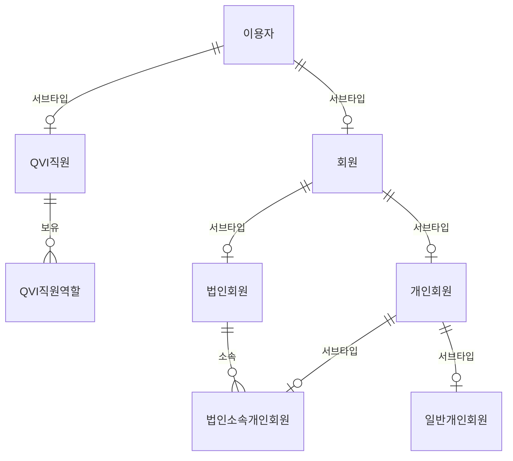

# QVI 이용자 논리 모델

> 현재 문서는 상세 논리 모델링 단계에서 참고할 후보 문서이다.
> 현재 기준선은 `doc/DB설계/QVI 개념 모델.md`이며, 개념 모델 확정 전까지 이 문서의 전체 속성/도메인/코드 정의는 확정 사항으로 보지 않는다.

## 1. 목적

이 문서는 `vlei_qvi_db_oracle.sql`을 기준으로 QVI 포탈의 이용자 영역을 재정의하기 위한 한글 논리 모델이다.

현재 DDL은 `admin_users`와 `legal_entities`가 각각 독립 테이블로 존재하여 로그인, 비밀번호, 활성 여부, 등록/수정 일시 같은 이용자 공통 속성이 분산되어 있다. QVI 사업자 관점에서는 이용자를 핵심 엔티티로 두고, QVI직원과 회원을 서브타입으로 분리하는 구조가 더 적합하다.

이 문서는 물리 모델을 확정하기 전 단계의 논리 모델이며, 표준용어, 표준속성, 표준도메인, 표준코드, 명명 규칙을 함께 정리한다.

## 2. 모델링 원칙

1. 이용자는 QVI 포탈에서 식별, 인증, 권한, 감사의 기준이 되는 키 엔티티이다.
2. 모든 이용자 계열 엔티티의 식별자는 `이용자번호`를 사용한다.
3. 이용자 공통 속성은 `이용자` 슈퍼타입에 둔다.
4. QVI직원, 회원, 법인회원, 개인회원별 고유 속성은 해당 서브타입에 둔다.
5. 논리 모델에서는 한글 표준용어를 우선 사용하고, 물리명은 별도 물리 모델 단계에서 확정한다.
6. 코드성 속성은 표준코드로 관리하고, Y/N 값은 여부 도메인을 사용한다.
7. 현재 Oracle DDL의 물리 속성은 즉시 삭제하지 않고, 논리 모델 확정 후 물리 모델로 변환한다.

## 3. 이용자 서브타입 구조

### 3.1 서브타입 판정

| 구분 | 모델링 방식 | 설명 |
| --- | --- | --- |
| 이용자 -> QVI직원/회원 | 배타 서브타입 | 한 이용자는 QVI 내부 직원이거나 외부 회원이다. |
| 회원 -> 법인회원/개인회원 | 배타 서브타입 | 회원은 법인 단위 회원이거나 개인 단위 회원이다. |
| 개인회원 -> 법인소속개인회원/일반개인회원 | 배타 서브타입 | 개인회원은 특정 법인에 소속되거나 개인 자격으로 가입한다. |
| QVI직원 -> 관리자/담당자 | 역할 테이블 | 관리자와 담당자는 동시에 부여될 수 있으므로 서브타입보다 역할 부여 모델을 우선한다. 단, 업무적으로 상호배타가 확정되면 `QVI관리자`, `QVI담당자` 서브타입으로 분리한다. |

## 4. 엔티티 정의

### 4.1 이용자

QVI 포탈에 접근하거나 QVI 업무의 행위자로 기록될 수 있는 모든 주체의 슈퍼타입이다.

| 속성명 | 필수 | 도메인 | 설명 | 기존 DDL 대응 |
| --- | --- | --- | --- | --- |
| 이용자번호 | Y | 이용자번호 | 이용자 식별자 | `admin_users.id`, `legal_entities.id` |
| 이용자구분코드 | Y | 이용자구분코드 | QVI직원/회원 구분 | 신규 |
| 로그인ID | Y | 이메일주소 | 포탈 로그인 식별자. 초기에는 이메일 사용 | `admin_users.email`, `legal_entities.portal_email` |
| 비밀번호해시값 | N | 해시값 | 포탈 인증용 비밀번호 해시 | `admin_users.password_hash`, `legal_entities.portal_password_hash` |
| 이메일주소 | N | 이메일주소 | 연락 이메일. 로그인ID와 다를 수 있음 | `admin_users.email`, `legal_entities.contact_email` |
| 휴대전화번호 | N | 전화번호 | 본인확인/알림용 전화번호 | `legal_entities.contact_phone` 일부 |
| 이용자상태코드 | Y | 이용자상태코드 | 가입신청/활성/정지/탈퇴/잠김 | `is_active`, `is_portal_active` |
| 최종로그인일시 | N | 일시 | 마지막 로그인 시각 | `admin_users.last_login_at` |
| 등록일시 | Y | 일시 | 최초 등록 시각 | `created_at` |
| 수정일시 | Y | 일시 | 마지막 수정 시각 | `updated_at` |

### 4.2 QVI직원

QVI 사업자 내부에서 포탈 운영, 신청 심사, 발급 처리, 조회 업무를 수행하는 직원이다.

| 속성명 | 필수 | 도메인 | 설명 | 기존 DDL 대응 |
| --- | --- | --- | --- | --- |
| 이용자번호 | Y | 이용자번호 | 이용자 슈퍼타입 식별자 | `admin_users.id` |
| 직원번호 | N | 직원번호 | 내부 인사 시스템 직원번호 | 신규 |
| 직원명 | Y | 성명 | QVI 직원 성명 | `admin_users.name` |
| 부서명 | N | 명칭 | 소속 부서 | 신규 |
| 직위명 | N | 명칭 | 직위/직책 | 신규 |
| 재직상태코드 | Y | 재직상태코드 | 재직/휴직/퇴직 | 신규 |

### 4.3 QVI직원역할

QVI직원이 보유한 포탈/업무 권한이다.

| 속성명 | 필수 | 도메인 | 설명 | 기존 DDL 대응 |
| --- | --- | --- | --- | --- |
| 이용자번호 | Y | 이용자번호 | QVI직원 식별자 | `admin_users.id` |
| QVI직원역할코드 | Y | QVI직원역할코드 | 슈퍼관리자/관리자/심사담당자/조회자 | `admin_users.role` |
| 역할부여일시 | Y | 일시 | 역할 부여 시각 | 신규 |
| 역할회수일시 | N | 일시 | 역할 회수 시각 | 신규 |
| 역할부여자이용자번호 | N | 이용자번호 | 역할을 부여한 QVI직원 | 신규 |

### 4.4 회원

QVI 서비스를 이용하는 외부 고객의 슈퍼타입이다.

| 속성명 | 필수 | 도메인 | 설명 | 기존 DDL 대응 |
| --- | --- | --- | --- | --- |
| 이용자번호 | Y | 이용자번호 | 이용자 슈퍼타입 식별자 | `legal_entities.id` 일부 |
| 회원구분코드 | Y | 회원구분코드 | 법인회원/개인회원 | 신규 |
| 회원가입일시 | Y | 일시 | 회원 가입 시각 | `legal_entities.created_at` |
| 회원상태코드 | Y | 회원상태코드 | 신청/활성/정지/탈퇴 | `is_portal_active` |
| 약관동의일시 | N | 일시 | 서비스 약관 동의 시각 | 신규 |
| 개인정보동의일시 | N | 일시 | 개인정보 수집/이용 동의 시각 | 신규 |

### 4.5 법인회원

Legal Entity 단위로 QVI에 가입하여 LE vLEI 발급을 신청하는 회원이다.

| 속성명 | 필수 | 도메인 | 설명 | 기존 DDL 대응 |
| --- | --- | --- | --- | --- |
| 이용자번호 | Y | 이용자번호 | 회원 식별자 | `legal_entities.id` |
| 법인식별자 | Y | LEI | ISO 17442 LEI | `legal_entities.lei` |
| 법인명 | Y | 법인명 | 법인 공식 명칭 | `legal_entities.legal_name` |
| 국가코드 | Y | 국가코드 | ISO 3166-1 alpha-2 | `legal_entities.country` |
| 사업자등록번호 | N | 사업자등록번호 | 국내 법인 식별 보조값 | 신규 또는 기존 CA `ssn` 대응 |
| 업종명 | N | 명칭 | 업종 | `legal_entities.business_type` |
| 대표자명 | N | 성명 | 대표자 성명 | 기존 CA `ceo_name` 대응 |

법인 AID와 credential registry는 법인회원 속성으로 직접 관리하지 않고 `KERI 식별자 논리 모델`의 `KERI식별자`, `KERI식별자보유관계`, `CredentialRegistry`에서 관리한다.

### 4.6 개인회원

자연인 단위로 QVI 서비스에 가입하는 회원의 슈퍼타입이다.

| 속성명 | 필수 | 도메인 | 설명 | 기존 DDL 대응 |
| --- | --- | --- | --- | --- |
| 이용자번호 | Y | 이용자번호 | 회원 식별자 | 신규 |
| 개인회원구분코드 | Y | 개인회원구분코드 | 법인소속/일반 | 신규 |
| 성명 | Y | 성명 | 개인회원 성명 | 기존 CA `user_name` 대응 |
| 생년월일 | N | 일자 | 본인확인용 생년월일 | 기존 CA `qc_birth_date` 대응 |

개인 또는 직원 wallet AID는 개인회원 속성으로 직접 관리하지 않고 `KERI 식별자 논리 모델`의 `KERI식별자`와 관계 엔터티에서 관리한다.

### 4.7 법인소속개인회원

특정 법인회원에 소속되어 OOR/ECR 등 법인 역할 credential을 받을 수 있는 개인회원이다.

| 속성명 | 필수 | 도메인 | 설명 | 기존 DDL 대응 |
| --- | --- | --- | --- | --- |
| 이용자번호 | Y | 이용자번호 | 개인회원 식별자 | 신규 |
| 소속법인이용자번호 | Y | 이용자번호 | 소속 법인회원의 이용자번호 | 신규 |
| 사원번호 | N | 사원번호 | 법인 내부 사원번호 | 신규 |
| 부서명 | N | 명칭 | 소속 부서 | 신규 |
| 직위명 | N | 명칭 | 직위/직책 | 신규 |
| 소속상태코드 | Y | 소속상태코드 | 재직/휴직/퇴직/소속해제 | 신규 |
| 소속시작일자 | N | 일자 | 소속 시작일 | 신규 |
| 소속종료일자 | N | 일자 | 소속 종료일 | 신규 |

### 4.8 일반개인회원

특정 법인에 소속되지 않고 개인 자격으로 QVI 서비스를 이용하는 개인회원이다. 초기 PoC에서는 범위 밖이지만, 코인 거래 등 개인 wallet 사용을 고려해 논리 모델에 명시한다.

| 속성명 | 필수 | 도메인 | 설명 | 기존 DDL 대응 |
| --- | --- | --- | --- | --- |
| 이용자번호 | Y | 이용자번호 | 개인회원 식별자 | 신규 |
| 개인서비스구분코드 | N | 개인서비스구분코드 | 일반 개인회원의 서비스 이용 구분 | 신규 |

## 5. 주요 업무 규칙

1. 모든 이용자는 하나의 `이용자번호`로 식별한다.
2. 이용자는 반드시 하나의 `이용자구분코드`를 가진다.
3. `이용자구분코드 = QVI직원`인 경우 `QVI직원` 서브타입이 반드시 존재한다.
4. `이용자구분코드 = 회원`인 경우 `회원` 서브타입이 반드시 존재한다.
5. 회원은 법인회원 또는 개인회원 중 하나여야 한다.
6. 개인회원은 법인소속개인회원 또는 일반개인회원 중 하나여야 한다.
7. 법인소속개인회원은 반드시 하나의 활성 법인회원에 소속되어야 한다.
8. 법인회원은 LEI를 필수로 보유한다.
9. 동일한 LEI는 하나의 활성 법인회원에만 매핑된다.
10. 법인회원의 AID는 LE vLEI 신청 또는 wallet 수락 과정에서 생성/확정될 수 있으며, `KERI식별자보유관계`로 관리한다.
11. QVI직원은 하나 이상의 QVI직원역할을 가질 수 있다.
12. QVI직원역할은 회수 이력을 남기기 위해 삭제하지 않고 `역할회수일시`로 종료 처리한다.
13. 로그인ID는 활성 이용자 내에서 유일해야 한다.
14. 비밀번호는 평문 저장을 금지하고 `비밀번호해시값`만 저장한다.
15. 신청, 심사, 첨부 확인, 폐기, 권한 변경은 모두 감사 로그의 행위자 `이용자번호`로 추적한다.
16. vLEI 신청의 신청자는 법인회원 또는 법인소속개인회원이 될 수 있다.
17. vLEI 신청의 심사자는 QVI직원 중 심사 권한을 가진 이용자여야 한다.
18. OOR 신청의 대상자는 법인소속개인회원이어야 한다.
19. 일반개인회원은 법인 vLEI 또는 OOR 신청의 대상자가 될 수 없다.
20. 일반개인회원의 wallet 기능은 후속 단계 범위로 두되, 개인회원 모델 확장을 막지 않는다.

## 6. 기존 DDL 속성 재배치

| 기존 테이블 | 기존 속성 | 논리 엔티티 | 논리 속성 | 처리 방향 |
| --- | --- | --- | --- | --- |
| `admin_users` | `id` | 이용자 | 이용자번호 | 슈퍼타입으로 이동 |
| `admin_users` | `email` | 이용자 | 로그인ID/이메일주소 | 슈퍼타입으로 이동 |
| `admin_users` | `password_hash` | 이용자 | 비밀번호해시값 | 슈퍼타입으로 이동 |
| `admin_users` | `name` | QVI직원 | 직원명 | 서브타입으로 이동 |
| `admin_users` | `role` | QVI직원역할 | QVI직원역할코드 | 역할 엔티티로 이동 |
| `admin_users` | `is_active` | 이용자 | 이용자상태코드 | 코드화 |
| `admin_users` | `last_login_at` | 이용자 | 최종로그인일시 | 슈퍼타입으로 이동 |
| `legal_entities` | `id` | 이용자/회원/법인회원 | 이용자번호 | 슈퍼타입 식별자로 사용 |
| `legal_entities` | `lei` | 법인회원 | 법인식별자 | 서브타입으로 이동 |
| `legal_entities` | `legal_name` | 법인회원 | 법인명 | 서브타입으로 이동 |
| `legal_entities` | `country` | 법인회원 | 국가코드 | 서브타입으로 이동 |
| `legal_entities` | `business_type` | 법인회원 | 업종명 | 서브타입으로 이동 |
| `legal_entities` | `contact_email` | 이용자 또는 법인회원 | 이메일주소 | 연락처 정책 확정 필요 |
| `legal_entities` | `contact_phone` | 이용자 또는 법인회원 | 휴대전화번호/전화번호 | 연락처 정책 확정 필요 |
| `legal_entities` | `aid` | KERI식별자 | AID | KERI 식별자 주제영역으로 이관 |
| `legal_entities` | `registry_id` | CredentialRegistry | 레지스트리식별자 | KERI 식별자 주제영역으로 이관 |
| `legal_entities` | `portal_email` | 이용자 | 로그인ID | 슈퍼타입으로 이동 |
| `legal_entities` | `portal_password_hash` | 이용자 | 비밀번호해시값 | 슈퍼타입으로 이동 |
| `legal_entities` | `is_portal_active` | 이용자/회원 | 이용자상태코드/회원상태코드 | 코드화 |
| `admin_sessions` | `admin_user_id` | 이용자세션 | 이용자번호 | 모든 이용자 세션으로 일반화 |
| `login_codes` | `email` | 로그인인증코드 | 이메일주소 | 이용자번호 추가 검토 |
| `audit_log` | `actor_type`, `actor_id` | 감사로그 | 행위자구분코드, 행위자이용자번호 | 이용자번호 중심으로 변경 |

## 7. 표준용어 후보

| 표준용어 | 영문명 후보 | 설명 |
| --- | --- | --- |
| 이용자 | User | QVI 포탈 사용 주체 |
| 이용자번호 | User Number | 이용자 식별자 |
| 이용자구분코드 | User Type Code | QVI직원/회원 구분 |
| 로그인ID | Login ID | 포탈 로그인 식별자 |
| 비밀번호해시값 | Password Hash Value | 비밀번호 해시 |
| 이용자상태코드 | User Status Code | 이용자 상태 |
| QVI직원 | QVI Staff | QVI 내부 직원 |
| QVI직원역할 | QVI Staff Role | QVI 직원에게 부여된 업무/권한 역할 |
| QVI직원역할코드 | QVI Staff Role Code | 슈퍼관리자/관리자/심사담당자/조회자 |
| 회원 | Member | QVI 외부 이용자 |
| 회원구분코드 | Member Type Code | 법인회원/개인회원 |
| 법인회원 | Legal Entity Member | 법인 단위 회원 |
| 개인회원 | Individual Member | 개인 단위 회원 |
| 개인회원구분코드 | Individual Member Type Code | 법인소속/일반 |
| 법인소속개인회원 | Affiliated Individual Member | 법인에 소속된 개인회원 |
| 일반개인회원 | General Individual Member | 법인에 소속되지 않은 개인회원 |
| 법인식별자 | Legal Entity Identifier | LEI |
| KERI식별자 | KERI Identifier | KERI AID 업무 참조 엔터티 |
| KERI식별자보유관계 | KERI Identifier Holding Relationship | 주체와 AID의 선분 이력 관계 |
| KERI식별자운영권한 | KERI Identifier Operation Authority | 이용자와 AID의 운영 권한 선분 이력 |

## 8. 표준도메인 후보

| 도메인명 | 논리 타입 | 길이/형식 | 설명 |
| --- | --- | --- | --- |
| 이용자번호 | 문자 | 36 | 초기 PoC는 UUID 문자열 기준. 물리 모델에서 NUMBER 채번 여부 재검토 |
| 코드 | 문자 | 20~50 | 표준코드값 |
| 여부 | 문자 | 1 | Y/N |
| 이메일주소 | 문자 | 255 | 이메일 형식 |
| 전화번호 | 문자 | 50 | 국가번호 포함 가능 |
| 성명 | 문자 | 100~200 | 개인 성명 |
| 법인명 | 문자 | 500 | 법인 공식명 |
| 명칭 | 문자 | 100~500 | 일반 명칭 |
| 해시값 | 문자 | 255 | bcrypt/argon2 등 해시 문자열 |
| LEI | 문자 | 20 | ISO 17442 |
| AID | 문자 | 100 | KERI AID |
| 레지스트리식별자 | 문자 | 100 | KERI credential registry ID |
| 일자 | 날짜 | YYYY-MM-DD | 날짜 |
| 일시 | 타임스탬프 | TIMESTAMP(6) | 시각 |

## 9. 표준코드 후보

### 9.1 이용자구분코드

| 코드값 | 코드명 | 설명 |
| --- | --- | --- |
| QVI_STAFF | QVI직원 | QVI 내부 직원 |
| MEMBER | 회원 | 외부 회원 |

### 9.2 회원구분코드

| 코드값 | 코드명 | 설명 |
| --- | --- | --- |
| LEGAL_ENTITY | 법인회원 | 법인 단위 회원 |
| INDIVIDUAL | 개인회원 | 개인 단위 회원 |

### 9.3 개인회원구분코드

| 코드값 | 코드명 | 설명 |
| --- | --- | --- |
| AFFILIATED | 법인소속 | 특정 법인회원에 소속된 개인회원 |
| GENERAL | 일반 | 법인에 소속되지 않은 개인회원 |

### 9.4 QVI직원역할코드

| 코드값 | 코드명 | 설명 | 기존 DDL 대응 |
| --- | --- | --- | --- |
| SUPER_ADMIN | 슈퍼관리자 | QVI 포탈 전체 관리 | `SUPER_ADMIN` |
| ADMIN | 관리자 | 이용자/권한/시스템 설정 관리 | 신규 |
| REVIEWER | 심사담당자 | vLEI/OOR 신청 심사 및 승인 | `REVIEWER` |
| VIEWER | 조회자 | 조회 전용 | `VIEWER` |

### 9.5 이용자상태코드

| 코드값 | 코드명 | 설명 |
| --- | --- | --- |
| REQUESTED | 가입신청 | 가입 신청 상태 |
| ACTIVE | 활성 | 정상 이용 가능 |
| SUSPENDED | 정지 | 관리자에 의해 일시 정지 |
| LOCKED | 잠김 | 인증 실패 등으로 잠김 |
| WITHDRAWN | 탈퇴 | 탈퇴 또는 해지 |

### 9.6 소속상태코드

| 코드값 | 코드명 | 설명 |
| --- | --- | --- |
| ACTIVE | 재직 | 현재 소속 |
| LEAVE | 휴직 | 휴직 |
| RETIRED | 퇴직 | 퇴직 |
| RELEASED | 소속해제 | 소속 법인에서 해제 |

## 10. 명명 규칙 후보

### 10.1 논리명

1. 엔티티명은 한글 명사형으로 작성한다.
2. 속성명은 의미가 드러나는 한글 표준용어 조합으로 작성한다.
3. 식별자는 `번호`, 분류값은 `코드`, 명칭은 `명`, 시점은 `일시`, 날짜는 `일자`, Y/N 값은 `여부`를 접미어로 사용한다.
4. 동일 의미 속성은 모든 엔티티에서 동일한 표준속성명을 사용한다.
5. KERI/vLEI 용어는 필요한 경우 `AID`, `LEI`, `SAID`, `QVI`, `OOR`, `ECR`처럼 표준 약어를 허용한다.

### 10.2 물리명

물리명은 다음 단계에서 확정한다. 다만 후보 원칙은 다음과 같다.

1. 테이블명은 영문 대문자 스네이크 케이스를 사용한다.
2. 컬럼명은 영문 대문자 스네이크 케이스를 사용한다.
3. 기본키는 `{엔티티}_NO` 또는 `USER_NO`처럼 표준 식별자 접미어를 사용한다.
4. 코드 컬럼은 `_CD`, 명 컬럼은 `_NM`, 일시 컬럼은 `_DTTM`, 일자 컬럼은 `_DT`, 여부 컬럼은 `_YN`을 사용한다.
5. 기존 `id`, `email`, `status`, `role` 같은 범용명은 표준물리명으로 치환한다.

## 11. 후속 물리 모델 영향

논리 모델이 확정되면 현재 `vlei_qvi_db_oracle.sql`의 사용자 영역은 대략 다음 물리 테이블 후보로 재구성한다.

| 논리 엔티티 | 물리 테이블 후보 | 비고 |
| --- | --- | --- |
| 이용자 | `USERS` 또는 `TB_USER` | 명명 표준 확정 필요 |
| QVI직원 | `QVI_STAFF` 또는 `TB_QVI_STAFF` | 이용자번호 PK/FK |
| QVI직원역할 | `QVI_STAFF_ROLES` 또는 `TB_QVI_STAFF_ROLE` | 복수 역할 지원 |
| 회원 | `MEMBERS` 또는 `TB_MEMBER` | 이용자번호 PK/FK |
| 법인회원 | `LEGAL_ENTITY_MEMBERS` 또는 `TB_LEGAL_ENTITY_MEMBER` | 기존 `legal_entities` 대체 |
| 개인회원 | `INDIVIDUAL_MEMBERS` 또는 `TB_INDIVIDUAL_MEMBER` | 후속 wallet 확장 |
| 법인소속개인회원 | `AFFILIATED_INDIVIDUAL_MEMBERS` | 직원/소속 관계 |
| 일반개인회원 | `GENERAL_INDIVIDUAL_MEMBERS` | 개인 자격 서비스 |
| 이용자세션 | `USER_SESSIONS` | 기존 `admin_sessions` 일반화 |
| 로그인인증코드 | `LOGIN_CODES` | 이용자번호 연계 검토 |

## 12. 다음 검토 사항

1. QVI직원의 관리자/담당자를 상호배타 서브타입으로 볼지, 복수 역할로 볼지 최종 결정한다.
2. 법인회원의 연락처를 이용자 공통 연락처로 둘지, 법인 연락처로 별도 관리할지 결정한다.
3. 법인회원과 법인소속개인회원의 관계에서 한 개인이 여러 법인에 소속될 수 있는지 결정한다.
4. `이용자번호`의 물리 도메인을 UUID 문자열로 유지할지, Oracle sequence 기반 NUMBER로 전환할지 결정한다.
5. 표준코드를 공통 코드 테이블로 관리할지, 초기 PoC에서는 CHECK 제약으로 관리할지 결정한다.
6. vLEI 신청, OOR 신청, 첨부파일, 감사로그의 참조 컬럼을 `이용자번호` 기준으로 재정의한다.
